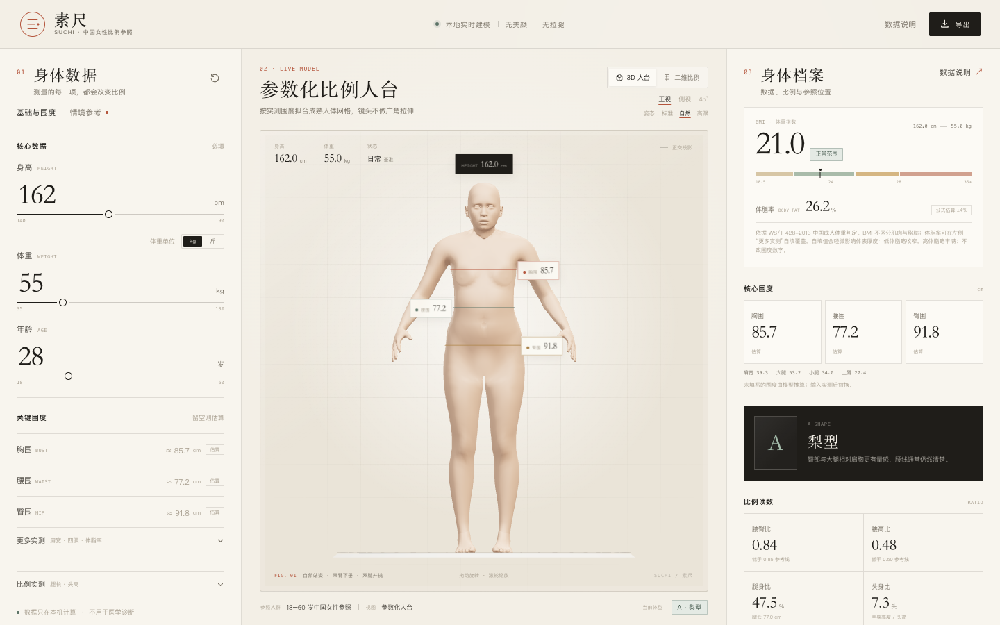
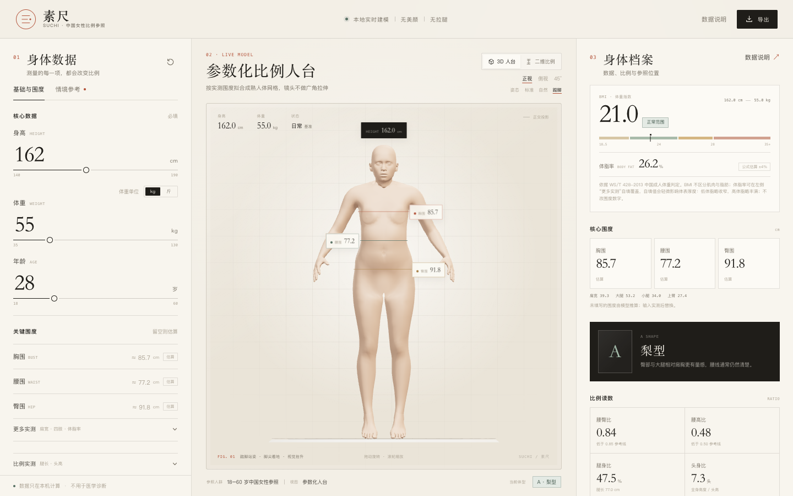
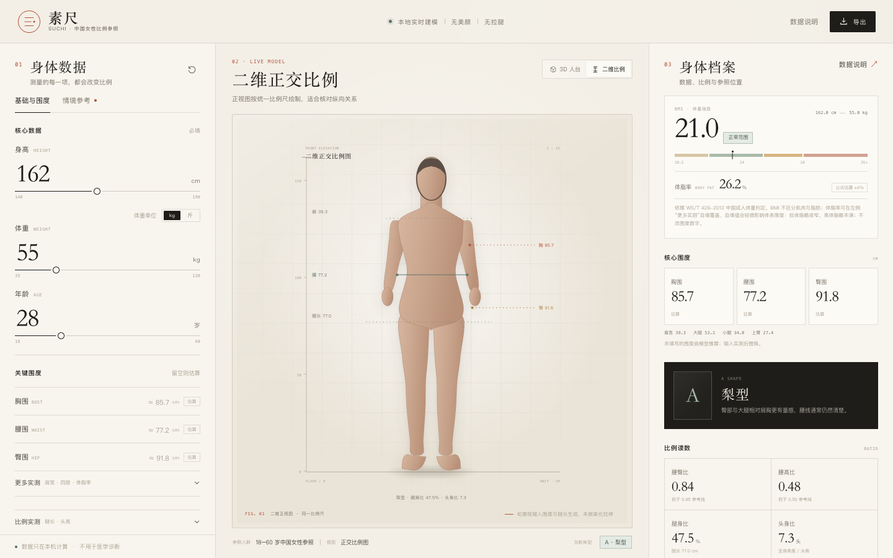

# 素尺 SUCHI · 中国女性参数化比例参照

一个**完全本地运行**的女性身体比例观察工具。输入身高、体重和可选围度，生成同一比例尺下的二维正视图与三维人台，并给出可追溯的 BMI、围度、腿身比、头身比和人群参照。

它不做“完美身材评分”，也不使用拉腿、缩腰、丰胸等视觉修饰。


<p align="left">
  
  
  
  
  
</p>

> 本项目的人台是**非写实、无性征细节的平滑比例模型**：不渲染乳头、生殖器等明确解剖结构，也不包含性化内容。它不是医学、服装打版或人体工程测量工具。

---

## 目录

- [这是什么](#这是什么)
- [预览](#预览)
- [功能](#功能)
- [快速开始](#快速开始)
- [部署到 GitHub Pages](#部署到-github-pages)
- [数据与准确性](#数据与准确性)
- [三维人台](#三维人台)
- [技术栈与结构](#技术栈与结构)
- [隐私](#隐私)
- [已知限制](#已知限制)
- [贡献](#贡献)
- [许可与致谢](#许可与致谢)

---

## 这是什么

- **比例观察工具**：把身高、体重、围度、腿长等参数转成同尺度的轮廓和读数。
- **不是审美评分器**：没有“理想身材”分数，没有“变瘦/变美”目标。
- **不是医学诊断**：BMI、腰围、体脂率只作参考，不替代体检或专业评估。
- **估算可被覆盖**：未填写的围度由模型估算并标注“估算”；填写后显示“实测”。
- **数据留在本机**：没有后端，没有上传，没有账号。

## 预览

**三维人台，自然站姿**（双臂下垂、双腿并拢）：



**踮脚站姿**（脚背下压、脚尖着地，不含鞋型）：



**二维正交比例图**（与 3D 使用同一组读数，同一比例尺）：



## 功能

- 身高、体重、年龄；支持 kg / 斤切换
- 胸围、腰围、臀围、肩宽、下胸围、大腿围、小腿围、上臂围、腕围
- 腿长、头高实测
- 骨架、日常活动量、脂肪分布倾向、比例倾向
- 日常、运动后、久坐、经期、产后恢复、围绝经期等情境预览
- 3D 测量拟合人台，正交相机，可旋转 / 缩放，标注三围
- 三种展示姿态：标准 A 姿、自然站姿、踮脚站姿
- 2D 正交比例图，含身高尺与测量线
- BMI、体脂率（可自填覆盖）、WHR、WHtR、腿身比、头身比
- 体型分类与人群百分位参照（带误差、数据缺口说明）
- 导出 PNG 比例画像、JSON 身体档案
- 单文件离线构建，无外部运行时资源

## 快速开始

### 环境

- Node.js **>= 20.19**（推荐 22 LTS）
- npm 10+
- 仅在重新生成 3D 资产时需要 Python 3.10+

### 安装与开发

```bash
npm ci
npm run dev
```

打开终端提示的地址（默认 `http://127.0.0.1:5178`）。

### 测试

```bash
npm test
```

当前包含 15 项单元测试，覆盖围度估算、体脂率覆盖、比例计算和生成资产元数据。

### 构建

```bash
npm run build
```

构建产物是 **单个 `dist/index.html`**：CSS、JavaScript、3D 数据全部内联，可以直接双击离线打开，也可以部署到任意静态托管。

### 重新生成 3D 资产

```bash
npm run build:body
```

脚本读取 `assets/parametric-base.glb`，生成 `src/three/bodyData.ts`。不需要 Blender，也不需要联网。详见 [docs/ARCHITECTURE.md](docs/ARCHITECTURE.md)。

## 部署到 GitHub Pages

仓库自带 [`.github/workflows/deploy.yml`](.github/workflows/deploy.yml)。

1. 把项目推送到 GitHub 的 `main` 分支；
2. 打开 **Settings → Pages → Build and deployment**；
3. Source 选择 **GitHub Actions**；
4. 之后每次推送，Actions 会自动运行测试、构建单文件，并发布到 Pages。

Vite 已配置 `base: './'`，所以部署在 `https://<user>.github.io/<repo>/` 子路径下也能正常工作。

## 数据与准确性

更完整的核验记录、公式、来源和未启用数据在 **[docs/DATA.md](docs/DATA.md)**。

先说明三条最重要的边界：

1. **身高 158.0 cm、体重 59 kg** 来自《中国居民营养与慢性病状况报告（2020年）》；这是全国成人参考，不是本应用自行生成的数字。
2. **胸围、腰围、臀围、肩宽、四肢围度**的初始估算，来自公开人体测量文献的常见区间校准，属于模型估算，**不是官方公布的全国均值**。
3. **地域下拉当前不改变几何或百分位**，因为缺少足够可靠、可公开核验的“性别 × 年龄 × 地区”围度表；应用会主动显示这个数据缺口，而不是伪造地区精度。

BMI 分类与腰围风险参考采用 **WS/T 428-2013**。体脂率默认使用 **Deurenberg (1991)** 公式估算，误差较大；可在“更多实测”中填写体脂秤 / BIA / DEXA 结果覆盖。

概览：

| 指标 | 来源 / 性质 |
|---|---|
| 身高、体重 | 国家级调查报告 / 成人参考 |
| BMI 分类、腰围风险 | WS/T 428-2013 |
| 胸腰臀、肩宽、四肢围度 | 文献区间校准 + 模型估算 |
| 体脂率 | Deurenberg 公式 / 用户实测覆盖 |
| 人群百分位 | 近似分布，不是官方百分位表 |

## 三维人台

基础人体与形态目标来自 **MakeHuman hm08 / MPFB2** 的 **CC0** 资产，经 [naver/anny](https://github.com/naver/anny) 与 [three.ws](https://github.com/nirholas/three.ws) 整理。

- 基础网格经过 `bodyFeminine = 0.7` 烘焙，并在头颈区域叠加 `bodyAsian = 0.38` 的面部特征；
- 采用无衣物、无毛发的平滑人台体表；
- 依据实测/估算的胸、腰、臀、肩、腿围，使用 22 个形态目标进行多轮拟合；
- 通过实时截面测量校验目标围度；
- 自然站姿用原始蒙皮权重带动手臂下垂、双腿并拢；踮脚姿态让脚背下压、脚尖着地；
- BMI 低于 18.5 时自动启用低体重视觉精瘦（`bodyThinner` + 轻微结构阴影）；
- 胸部与骨盆区域使用局部法线与集合平滑，隐藏乳头、生殖器等明确解剖细节；
- 相机默认正交投影，避免广角镜头造成的比例失真。

人台是参数化比例模型，不是人体扫描，也不追求明星肖像级还原。

## 技术栈与结构

- **React 19 + TypeScript**
- **Vite 7**，使用 `vite-plugin-singlefile` 生成单文件构建
- **Three.js** 正交相机、程序化材质、测量环与投影标签
- **SVG** 二维正视图
- **Vitest** 单元测试
- 纯前端，无数据库、无后端、无外部运行时资源

```text
src/
├─ domain/
│  ├─ anthropometry.ts    # 围度估算、比例、体型、百分位、二维几何
│  ├─ reference.ts        # 选项、人群锚点、情境修正、来源说明
│  └─ types.ts            # 输入 / 输出类型
├─ three/
│  ├─ anatomicalFigure.ts # 三维形态拟合、姿态、平滑体表、测量环
│  └─ bodyData.ts         # 自动生成的紧凑人体网格与形态目标
├─ components/
│  ├─ BodyStage.tsx       # Three.js 场景、相机、投影标签
│  ├─ ProportionChart.tsx # 二维 SVG 正视图
│  ├─ InputPanel.tsx      # 输入 / 情境面板
│  ├─ MetricsPanel.tsx    # 指标 / 百分位 / 健康参考
│  ├─ DataDialog.tsx      # 数据来源与方法说明
│  └─ Controls.tsx        # 表单控件
├─ App.tsx                # 状态、布局、导出
└─ styles.css             # 设计系统与响应式布局

scripts/
└─ build_body_asset.py    # 从 CC0 基础网格生成 src/three/bodyData.ts

assets/
├─ parametric-base.glb    # MakeHuman hm08 / MPFB2 原始输入（CC0）
├─ LICENSE-CC0.md
└─ README.md              # 资产来源与再生成说明
```

架构细节见 [docs/ARCHITECTURE.md](docs/ARCHITECTURE.md)。

## 隐私

- 所有计算、3D 拟合、导出都在浏览器内完成；
- 没有 API 请求、没有分析脚本、没有远程字体；
- 导出的 PNG / JSON 只写入本地下载目录；
- 刷新页面即清空当前输入。

## 已知限制

- 围度估算误差可能在数厘米量级；有条件的用户应优先输入实测值。
- 百分位基于近似分布，不应当作官方百分位表引用。
- 体脂率默认公式在 BMI 极端区间误差较大；自填值才参与体表厚度修正。
- 自填体脂率会轻微改变 3D 体表厚度：低体脂略收窄、高体脂略丰满；胸腰臀和 BMI 数字不变。
- 经期、产后、围绝经期等状态修正是方向性、情境性的，不是预测。
- 3D 人台是参数化拟合，不是人体扫描；没有眼部纹理、毛发与明确生殖器细节。
- 踮脚姿态的视觉抬升、低 BMI 视觉精瘦都只影响 3D 体表，不改变身高、围度、BMI 或百分位读数。
- 形态目标只能逼近输入围度，不能用于服装打版、医学或人体工程测量。
- 当前版本不包含孕期、术后等需要专业医学指导的状态。

## 贡献

欢迎提交 issue 和 PR。请先阅读 [CONTRIBUTING.md](CONTRIBUTING.md)。

涉及数据的改动，需要在 PR 中写明来源、可核验性和适用人群；不要把估算包装成官方统计，也不要把单一样本写成全国均值。

## 许可与致谢

- **代码**：MIT，见 [LICENSE](LICENSE)。
- **3D 基础资产与形态目标**：CC0 1.0，来源与许可见 [assets/README.md](assets/README.md) 和 [assets/LICENSE-CC0.md](assets/LICENSE-CC0.md)。
- 感谢 MakeHuman / MPFB2、[naver/anny](https://github.com/naver/anny)、[three.ws](https://github.com/nirholas/three.ws) 的开放资产与整理工作。
- 数据来源与方法说明见 [docs/DATA.md](docs/DATA.md)。

---

**素尺不提供诊断、治疗方案、体重目标或“理想身材”建议。**
